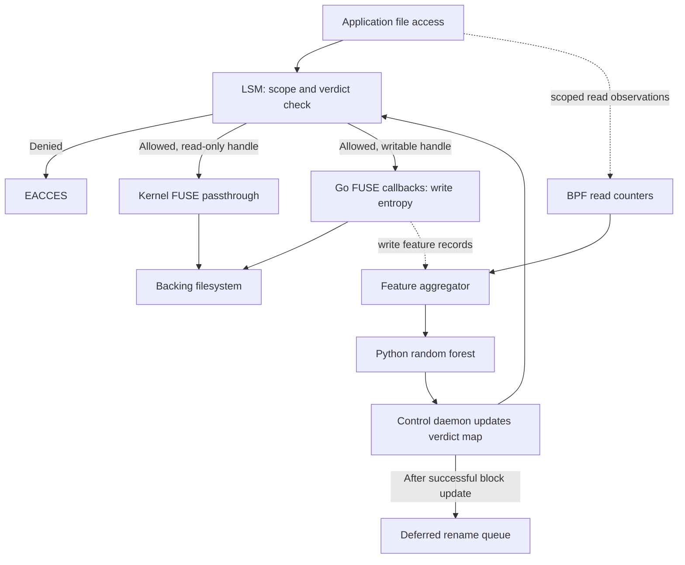

# Implementation plan: kernel enforcement and faster reads

Date: 2026-10-13. Branch: `analysis/ebpf-offload`.
Status: design only; no BPF programs were attached and no runtime code changed.

This plan supersedes the implementation ordering in `ebpf-offload-assessment.md`.
The agreed direction is immediate kernel enforcement after a malicious verdict,
deferred userspace renaming, and removal of Go from eligible read operations.

## Target behavior

- Before detection, permitted I/O proceeds and the detector receives features.
- After a malicious verdict is successfully published, subsequent covered access
  checks for that process return `EACCES`, including checks on already-open files.
- Renaming runs later in a separate worker. A slow or failed rename does not
  delay or undo the block.
- Read-only handles use kernel FUSE passthrough where supported. Writable handles
  retain userspace entropy processing in the first implementation.
- Python retains the five-feature random forest, with feature compatibility
  measured before claiming equivalent detection accuracy.

"Immediate" starts at verdict publication. The existing five-second feature
window and inference time remain detection latency. An operation that already
passed its security check may finish; the design does not undo prior I/O or
revoke bytes already copied into application memory.

## Reference: local BpfShield

Inspected `/home/sambhav/BpfShield` source, without running its scripts/binaries.
The relevant implementation is the small standalone LSM project at that root;
the bundled Tetragon tree is not required for this plan.

| Reference | Reuse | Adaptation needed |
| --- | --- | --- |
| `enforce.bpf.c:45` | `SEC("lsm/inode_permission")`, CO-RE reads, map decisions, preservation of prior `ret`, denial with `-13` | Add `file_permission` for access through already-open descriptors; use named `EACCES`; evaluate all requested permission bits |
| `loader.c:8,92` | Open object, reuse pinned map FDs, load, `bpf_program__attach_lsm` | Validate map ABI, handle errors/FD ownership, pin links, implement controlled shutdown/restart |
| `file_permission.py` | Userspace policy publication into maps | Despite its name this is a map-population script, not a `file_permission` hook; replace subprocess/bpftool updates with daemon IPC and direct map updates |
| `transition.bpf.c` | Process lifecycle instrumentation | Consistent TGID/thread handling, task lifetime identifiers, exit cleanup and explicit inheritance; no executable-name transition policy needed initially |

Do not copy the sample's bare inode-number or bare-PID keys. Inodes collide across
filesystems, and PIDs are reused. Its `if READ / else if WRITE` also ignores the
write bit when both are requested. Use the `.bpf.c` plus libbpf-loader approach;
the alternative `loader.py` names a function absent from `enforce.c`.

Create project-owned maps and links under `/sys/fs/bpf/fs_mtd/`. Do not run
`createMaps.sh`: it removes the reference project's existing pinned map paths.

## Architecture

LSM enforcement and read telemetry use separate hooks: permission checks are not
one-to-one with completed reads. Neither hook performs file-data reads itself.
Open/close and namespace operations still involve FUSE; the speedup target is
eligible read data operations.

## Milestone 1: enforce a supplied verdict

Implement a small CO-RE C/libbpf daemon using the BpfShield loading pattern.
Test on a dedicated fixture mount with manual verdict updates first, before
depending on classifier behavior or changing the read transport.

Kernel responsibilities:

- `lsm/file_permission`: check existing descriptors for `MAY_READ`/`MAY_WRITE`.
- `lsm/inode_permission` and/or `lsm/file_open`: reject scoped new access with
  the appropriate file context; preserve any previous LSM denial.
- Inspect target-kernel paths for truncation, rename and unlink; add the relevant
  LSM hooks before advertising those operations as protected. Test `O_TRUNC`
  explicitly: a later write check cannot undo truncation.
- Return errors synchronously. Emit optional denial events without making
  enforcement depend on ring-buffer capacity or userspace acknowledgement.

State and control:

| Map | Key/value purpose |
| --- | --- |
| `protected_scopes` | Explicit protected filesystem/mount identities and scope generation |
| `blocked_processes` | Host TGID + process-lifetime token + scope -> denied operation mask and verdict generation |
| `task_identity` | Resolve observed host TID to process identity for joining FUSE and BPF events |
| `read_stats` | Process identity + scope + monotonic window -> read count and diagnostics |
| `health` | Map/update failures, event drops, attachment status and collector generation |
| `events` | Bounded ring buffer for denial/lifecycle diagnostics, not per-read CSV |

For the first integrated prototype protect the entire FUSE filesystem instance,
identified from its superblock/device with explicit major/minor conversion and
mount lifecycle management. Bind aliases must not bypass the same scope. Keep the
backing directory inaccessible to monitored applications using permissions and
mount layout; service access is outside the application's exposed namespace.
A standalone native-file benchmark instead uses a dedicated protected filesystem
or explicit registered file identities. Arbitrary recursive subtree policy is a
separate extension, not an inode-number-only lookup.

Use process lifetime from the kernel, shared across threads; do not assume Python's
PID namespace or `/proc` timestamp units match kernel fields. Initially run the
FUSE daemon and control daemon in the host PID namespace and join FUSE caller TIDs
through `task_identity`. Treat unresolved attribution as an invalid feature window.

Keep a verdict across exec. A child forked after its parent is blocked inherits
the block. Existing children are independently classified in this first policy;
whole-process-tree quarantine would require additional tracking. Include exit
cleanup while retaining lifetime tokens as protection against stale entries.

The control daemon owns maps and provides a restricted Unix socket for classifier
updates. Use direct map syscalls, never spawn `bpftool` per verdict. A successful
update acknowledgement precedes queueing the rename. Denials stay latched until
explicit reset/process exit, with no automatic LRU eviction of enforcement state.
An update failure is an enforcement failure, not a successful classification action.

Pin links/maps so a daemon restart can preserve existing blocks. If the classifier
stops, existing blocks remain; new malicious behavior will not be classified.
Expose this degraded state. Start the monitored workload only after required
attachments and scope setup succeed; shutdown/unpin must be explicit.

Acceptance: a process opens a fixture file, reads successfully, receives a block,
then gets `EACCES` on its next covered read/write using that same descriptor.
Unrelated processes and out-of-scope files remain unaffected. Threading, PID reuse,
fork/exec, combined permission masks, full maps and previous LSM denials are tested.

## Milestone 2: supply features and publish classifier verdicts

- Remove verdict-file polling and inline renaming from `RenameFile.Read`.
- Collect read activity in BPF at application-facing I/O hooks, excluding backing
  I/O by the FUSE daemon. Begin with explicit `read`/`pread` coverage and add
  vectored reads with tests. Use entry/exit correlation for result classification;
  do not count `file_permission` invocations as reads.
- Define the new read feature as one successful nonzero logical read per supported
  request, with failures/EOF tracked separately. Count each request once on the
  visible FUSE file, excluding nested backing reads. This is a changed feature
  definition compared with FUSE callbacks and requires accuracy validation.
- Keep all writes through the existing callback initially; preserve per-callback
  counts and full-buffer entropy semantics for the model-comparison baseline.
  Record write return values separately for diagnostics. Use a `[256]` histogram.
- Replace CSV handoff with bounded binary records to an aggregator, using a shared
  monotonic epoch. Go sends write summaries to the control daemon over a persistent
  local connection; Python receives completed feature rows. Read counters and write
  records carry the same process identity and window generation.
- Retain `entropy_max, entropy_mean, entropy_min, sum_writes, sum_reads` order and
  the low-entropy-extension filter. Preserve the unweighted per-write entropy mean
  and no-prediction behavior for windows with no qualifying entropy writes.
- Publish the identity of each suspicious process instead of the current global
  boolean. Python continues processing after a detection.
- Use window completion/watermarks with an explicit in-flight accounting policy.
  Do not read-and-delete maps while producers update them. Bound queues/maps,
  detect gaps and mark incomplete windows; never quietly call them benign.

Acceptance: deterministic benign fixtures give expected read/write features;
thread-to-process joining is correct; classification updates the right map entry;
windows survive idle periods, boundaries, process exit and transport restarts.
Compare the old and new feature distributions. Without labeled training/evaluation
data, report model compatibility as unresolved instead of claiming unchanged accuracy.

## Milestone 3: bypass Go on eligible reads

This is the milestone that removes kernel-to-Go read request/reply overhead.
Milestone 1 improves enforcement; it does not by itself make permitted reads faster.

Environment gate: select and boot a tested kernel with `CONFIG_FUSE_PASSTHROUGH`,
BPF LSM and BTF, expose `/dev/fuse`, and verify required capabilities. Upstream
passthrough is present in Linux 6.9; current local Linux 6.8 lacks the config.
Modernize this fork's FUSE protocol support narrowly before negotiating it.

Required code areas:

- `fuse/types.go`, `fuse/opcode.go`: current protocol layouts, extended capability
  negotiation, backing ID and stack-depth fields, passthrough flags; preserve
  correct layout/response sizing for older kernels and the Darwin build.
- New Linux-only backing-file registration API and cleanup in `fuse/`.
- `fs/api.go`, `fs/bridge.go`: pass registered backing IDs through open/create
  responses without changing unrelated filesystem implementations.
- `rename_fs/main.go`: select handle mode and preserve write observation.

Test inode/handle mode management in a small prototype first. Read-only opens
can use `FOPEN_PASSTHROUGH`. In Linux 6.9, all opens while that inode is in
passthrough mode must carry passthrough, and ordinary cached opens conflict.
The kernel explicitly supports `FOPEN_PASSTHROUGH | FOPEN_DIRECT_IO` to send
read/write data operations to the daemon while mapping uses the backing file.
Evaluate this combination for writable handles so their writes still reach the
entropy callback. Do not simply enable passthrough on O_RDONLY and leave cached
O_RDWR handles unchanged.

Maintain one coordinated backing registration per active inode, with reference
counts across opens, so concurrent handles do not supply conflicting backing IDs.
Manage FDs/registrations on errors, release, daemon shutdown and unlink/replacement.
Validate access flags and capability restrictions on the chosen kernel version.

Reads on writable handles remain in Go in this phase. Full read offload for
O_RDWR handles requires moving write observation too, or further filesystem work;
standard passthrough has no general "bypass reads only" switch for one handle.

Mapping policy for the initial controlled prototype: deny new file-backed mmap
of the protected scope while enforcement is active, with no preexisting mappings
in the fixture. The passthrough/direct-I/O combination otherwise permits backing
file mmap, and `file_permission` cannot revoke an already-created mapping.
Supporting mmap transparently is separate work; do not claim it is covered by
ordinary read/write hooks. Similarly, io_uring, splice and copy_file_range require
explicit attribution/coverage tests before inclusion in the supported workload.

Acceptance: permitted O_RDONLY data reads cause zero Go read callbacks after
open, and a published block still rejects reads on that same handle. Concurrent
read-only/writable opens in either order succeed with correct data and entropy
events; no stale data, leaked backing IDs, missing write callbacks or double counts.
Repeat on the exact deployment kernel. If mode coordination fails, retain ordinary
FUSE for that configuration and report that the bypass milestone is incomplete.

## Milestone 4: deferred rename response

After enforcement acknowledgement, enqueue a bounded, deduplicated response job
containing scope, stable file identity and verdict generation. A userspace worker
resolves the current name, checks identity again and performs the rename. Handle
replacement, hard links, existing destination names, deletion and retry races.

Perform namespace changes through a path that keeps FUSE's inode tree and caches
coherent, rather than reusing the current direct `f.node.Rename` call. Ensure the
trusted worker can execute its narrowly scoped response without being attributed
to the blocked application. The existing Create-node bug and error handling must
be fixed before enabling this worker. Start with the worker disabled; blocking
remains fully testable independently.

Acceptance: a paused/failing worker never delays denial; duplicate jobs do not
repeatedly prepend underscores; a replaced file is not renamed by a stale job.

## Milestone 5: measure the result

Compare on identical fixtures and storage:

1. Native filesystem baseline.
2. Existing FUSE detector, with known correctness issues documented.
3. Corrected FUSE detector plus LSM and streaming features, without passthrough.
4. The same setup with read-only passthrough enabled.

Use 4 KiB/64 KiB sequential and random reads, warm/cold cache, one/many threads,
and mixed read/write opens. Measure IOPS/throughput, p50/p95/p99 latency, Go callback
counts, system/user CPU, context switches, map/event loss and memory consumption.
Compare phases 3/4 to isolate the bypass gain. Also measure detection delay and
verdict-publication-to-first-denial delay separately. No speedup target is claimed
before these benchmarks.

## Proposed implementation units

| Unit | Files/areas |
| --- | --- |
| BPF enforcement, lifecycle and shared ABI | `bpf/enforce.bpf.c`, `bpf/process.bpf.c`, `bpf/common.h` |
| Read feature collection | `bpf/read_stats.bpf.c` |
| libbpf loader, maps, control socket, aggregation | `cmd/fs-mtd-agent/` |
| Model adapter and per-process verdicts | `MA_custom_filesystems/python_classifier/detection_system.py` |
| Callback simplification and write features | `MA_custom_filesystems/rename_fs/main.go`, `utils.go` |
| Passthrough protocol and lifecycle | `fuse/`, `fs/` as listed above |
| Deferred response | `cmd/fs-mtd-responder/` |
| Benign fixtures and performance harness | `tests/ebpf/`, `benchmark/ebpf/` |

All new paths above are planned, not implemented. Build/runtime tests for the
implementation require the environment gate; only source review was done here.

## Primary references

- [BPF LSM loading and return semantics](https://docs.kernel.org/bpf/prog_lsm.html)
- [File-permission hook and mmap limitations](https://www.kernel.org/doc/html/v6.8/core-api/kernel-api.html)
- [FUSE passthrough API and requirements](https://docs.kernel.org/filesystems/fuse/fuse-passthrough.html)
- [Linux 6.9 FUSE I/O-mode rules](https://raw.githubusercontent.com/torvalds/linux/v6.9/fs/fuse/iomode.c)
- [Linux 6.9 backing-file lifetime](https://raw.githubusercontent.com/torvalds/linux/v6.9/fs/fuse/passthrough.c)
