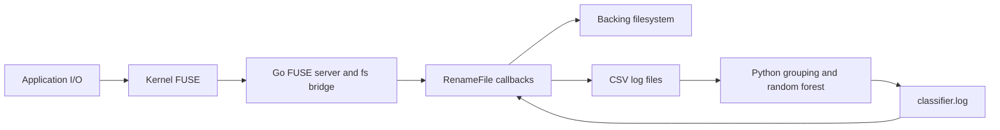

# FS-MTD-Detection: eBPF offload assessment

Reviewed 2026-10-13 at base commit `1256fe7`, on branch `analysis/ebpf-offload`.
This branch adds an assessment only; it does not change runtime behavior.

Follow-up: [implementation plan](ebpf-implementation-plan.md) incorporates the
local BpfShield reference and the decision to block in LSM immediately after
verdict publication while deferring renaming. Its milestone order supersedes
the exploratory sequence below.

## Recommendation

Use eBPF for scoped filesystem telemetry, integer aggregation, and enforcement
of userspace verdicts. Keep the random forest, entropy math, and rename response
in userspace initially. Moving work into the kernel is useful when it eliminates
serialization, disk IPC, or repeated transitions; merely attaching probes to the
current FUSE filesystem adds work and does not eliminate its request/reply path.

The largest potential throughput improvement is serving file data directly from
a native filesystem, with eBPF monitoring/enforcement alongside it. That is an
architecture change, not a drop-in eBPF replacement for Go-FUSE. If the FUSE mount
must remain, consider modern FUSE passthrough after moving observation and
response out of its read/write callbacks. No end-to-end speedup is measured here.

## Repository map

The repository is a fork of `github.com/hanwen/go-fuse/v2`, not solely a detector.
The custom application uses a loopback filesystem; it does not mount the separate
`newunionfs` implementation or Linux OverlayFS.

| Area | Responsibility | Relevance to migration |
| --- | --- | --- |
| `MA_custom_filesystems/rename_fs/main.go` | Mount setup, custom file handles, write entropy, per-operation CSV logging, verdict-triggered rename on read | Main application hot path |
| `MA_custom_filesystems/rename_fs/utils.go` | Reads global verdict file; byte entropy calculation | Repeated disk IPC and payload processing |
| `MA_custom_filesystems/python_classifier/` | CSV consumption, five-second/PID feature grouping, pickled random forest | Detector and model compatibility |
| `fs/` | Inode tree, modern node API, raw FUSE bridge, POSIX loopback, memory files | Filesystem semantics; retain if FUSE remains |
| `fuse/` | Mounting, `/dev/fuse` request parsing/dispatch, replies, buffers, Linux/Darwin support | Userspace transport overhead |
| `fuse/nodefs/`, `fuse/pathfs/` | Older node/path APIs and adapters | Not the custom detector's primary path |
| `splice/`, `fuse/splice_linux.go` | Pipe pooling and kernel splice-based read replies | Existing copy avoidance, not an eBPF target |
| `newunionfs/` | Separate union filesystem, promotion and deletion markers | Not mounted by the detector |
| `zipfs/` | ZIP/TAR and multi-archive filesystems | Not used by the detector |
| `example/` | Sample mounts and throughput tools; `rename` is a related prototype | Reference implementations, not the deployed detector |
| `benchmark/` | Generic read/stat/filesystem benchmarks and latency maps | Useful infrastructure, but no detector-specific baseline |
| `posixtest/`, package tests, `internal/` | POSIX conformance, mount helpers, access checks, platform utilities | Regression coverage for filesystem behavior |
| `MA_custom_filesystems/ransomware_samples/` | Bundled evaluation workloads and executables | Reviewed statically; not executed |
| `go.mod`, `all.bash`, `.github/workflows/ci.yml` | Old module dependencies, Linux/Darwin build and test workflow | Build modernization may be needed independently |

The model's pickle metadata names `RandomForestClassifier`, decision trees, and
the same five features used in Python. Metadata was inspected with `pickletools`,
without loading the model. There is no model-training pipeline or training dataset
in this checkout, so accuracy after changing feature definitions cannot be assumed.

## Current execution path

`RenameFile.Write` (`main.go:118`) holds a file-handle mutex, extracts the
extension, scans the complete FUSE write buffer for entropy, formats/logs a CSV
record, then calls `Pwrite`. The process-wide Go logger also serializes logging.
The recorded event precedes the underlying write, so it describes an attempted
callback, not necessarily a successful write or its actual byte count.

`RenameFile.Read` (`main.go:141`) holds its mutex, reads/parses `classifier.log`,
conditionally attempts a rename, logs a CSV row, then returns a file-descriptor
read result. `fuse/read.go` and `fuse/splice_linux.go` already allow payloads to
use splice where available, with a buffered fallback. Do not assume all read
payloads are copied into Go for inspection.

Python's `prepare_dataset` (`detection_system.py:54`) counts all observed reads
and writes by `(time_id, pid)`, then computes entropy minimum, unweighted mean,
and maximum only for writes with listed low-entropy extensions. `main` passes
`entropy_max, entropy_mean, entropy_min, sum_writes, sum_reads` to the model in
that order. A window without a qualifying write produces no prediction.

## What to replace

| Priority | Existing work | Proposed replacement | Expected benefit and constraint |
| --- | --- | --- | --- |
| 1 | `CsvDump`, per-I/O `log.Println`, rotating CSV files (`main.go:34,52,118,141`) | eBPF scoped events through a BPF ring buffer; asynchronous consumer | Removes CSV formatting/file writes from the I/O path. Requires a real event producer; a ring buffer alone does not move Go callbacks into the kernel. Track dropped events. |
| 1 | `isMalicious()` disk read on every FUSE read (`utils.go:10`) | Userspace verdict update to a BPF map, with BPF LSM checks | Replaces repeated file IPC with in-kernel lookup where checks apply. Simple cached atomic verdicts in Go are a cheaper first step if FUSE remains. |
| 2 | Python per-row operation counting (`detection_system.py:61`) | Kernel integer counters keyed by process identity and window | Export compact aggregates rather than every metadata event. Entropy aggregates require a separate entropy producer; counters alone cannot feed the existing model. |
| 2 | Passive observation through the FUSE mount | Scoped tracing at selected kernel I/O entry/exit points | Enables monitoring native filesystem I/O without a FUSE mediation path. Match scope and attribution; cover APIs explicitly instead of counting permission-hook invocations as I/O. |
| 3 | Full-buffer entropy (`utils.go:22`) | Optional bounded byte histogram in BPF; entropy computed in userspace | Can reduce exported payload, but adds kernel CPU and memory reads. Sampling changes features and can miss encrypted regions. Benchmark and validate/retrain before enabling. |
| Retain | `clf.predict` (`detection_system.py:95`) | Keep sklearn inference in userspace | Python/pickle/sklearn cannot be transplanted into eBPF. A separately exported bounded integer tree ensemble is possible engineering work, not the recommended first migration. |
| Retain | Rename on suspicious reads (`main.go:147`) | Userspace responder, detached from each read | eBPF does not provide a general filesystem-renaming facility. Kernel denial and pathname renaming are different responses. |
| Architectural | Go-FUSE read/write forwarding | Native filesystem, or supported FUSE passthrough plus eBPF | Removes data-path userspace transitions. Native access changes namespace/MTD behavior; passthrough bypasses the current callbacks and therefore their detector logic. |

BPF ring buffers provide memory-mapped consumption and nonblocking reservation;
full buffers cause reservation failure rather than stalling the writer. This
requires loss counters and an explicit incomplete-window policy.
[Kernel ring-buffer documentation](https://docs.kernel.org/bpf/ringbuf.html).

BPF LSM supports access decisions at security hooks. A candidate
`file_permission` program can check scoped file identity and a process verdict,
preserve a previous denial, and return an error for disallowed access. Start in
audit mode; denial changes the current rename behavior.
[BPF LSM documentation](https://docs.kernel.org/bpf/prog_lsm.html).

`file_permission` does not revalidate existing memory-mapped access. Mapping,
truncation, rename, unlink, asynchronous I/O and already-open descriptors need
explicit coverage and tests; one hook is not comprehensive ransomware prevention.
[Kernel file-permission API](https://www.kernel.org/doc/html/latest/core-api/kernel-api.html).

BPF programs can call only exposed helpers/kfuncs, not arbitrary kernel functions.
The ordinary BPF ISA provides integer arithmetic, not a direct implementation of
Go's floating-point `math.Log2`. Keep exact entropy math outside BPF; fixed-point
approximations would be a separate validated implementation.
[BPF call restrictions](https://docs.kernel.org/bpf/bpf_design_QA.html),
[BPF ISA](https://docs.kernel.org/bpf/standardization/instruction-set.html).

FUSE passthrough requires kernel support, handshake negotiation, backing-file
registration and open/create response changes. This checkout has no passthrough
symbols or backing-file registration support; enabling it is not a mount option
change. It bypasses userspace for supported data operations.
[Kernel FUSE passthrough documentation](https://docs.kernel.org/filesystems/fuse/fuse-passthrough.html).

## Compatibility traps to resolve before migration

1. **Attribution:** backing `Pwrite`/splice work executes in the FUSE daemon,
   not the original application's context. Probing only backing I/O reports the
   daemon identity. Prefer native application I/O for the long-term design; for
   a hybrid prototype correlate original FUSE caller/request identity explicitly.
   Filter daemon logging, classifier reads and responder operations to avoid
   self-generated events and double counting.
2. **Event semantics:** FUSE callbacks are not application syscall counts.
   Page-cache hits can avoid callbacks; buffering, splitting and writeback change
   event boundaries. Replacing callbacks with kernel syscall/VFS observations can
   change both counts and per-write entropy, even without sampling. Validate the
   feature distribution and model accuracy rather than claiming model parity.
3. **Entropy semantics:** preserve entropy per write-buffer event and the
   unweighted mean across qualifying writes. A merged window histogram computes
   a different quantity. An extension-aware histogram can be optional, but
   full-buffer and vectored writes require bounded iteration and verified access
   to payloads. Sampling userspace buffers is not an immutable record of exactly
   what was committed to disk.
4. **Scope:** use filesystem/mount/inode identities and an explicit protected
   set or bounded ancestry strategy, not only PID or filename prefixes. Handle
   hard links, renames, file replacement, inode reuse and mount namespaces.
5. **Identity:** the current model groups the FUSE `Caller.Pid` field as supplied.
   Explicitly choose thread versus process grouping in the replacement, account
   for PID namespaces, and include task lifetime information to prevent PID reuse
   from inheriting a verdict. Preserve suspicious PID associations after prediction;
   the existing Python code discards them and emits one global boolean.
6. **Windows/concurrency:** use a common monotonic epoch, bounded map capacity,
   update-failure counters and synchronized/per-CPU aggregation. Export completed
   windows with a defined policy for in-flight operations; reading/deleting live
   counters without coordination loses updates. Keep all-operation counts separate
   from the extension-filtered entropy event count.

## Existing issues that affect the baseline

- **Incomplete input:** Python reads `logfileN.csv` when it exists and immediately
  increments `counter` (`detection_system.py:83–87`). Go creates it at the start
  of a window and appends afterward. Python can permanently miss later rows,
  including after reading only a header; parse errors are also unhandled.
- **Rotation leaks:** `setLogFile` replaces logger output without closing the
  previous descriptor. The five-second rotation leaks descriptors. Appending on
  restart can reuse stale data and duplicate headers. Logger setup also starts
  in a goroutine, so mount processing does not wait for initialization.
- **Verdict behavior:** one suspicious PID makes the verdict global. Python then
  exits its loop, leaving the verdict latched; the message about termination does
  not kill the offending process. Reads continue after attempted renames, and
  writes do not consult the verdict. Verdict-file truncation/write is not atomic;
  Go ignores parse errors and treats invalid content as false.
- **Extension handling:** `strings.Split(name, ".")[1]` panics for names without
  a dot and selects the wrong suffix for multi-dot names. CSV fields are not
  escaped, so legal filenames containing commas/newlines can corrupt the input.
- **Rename correctness:** `Create` gives the file handle its containing directory
  node rather than the new child (`main.go:112`). In this fork, `LoopbackNode.Rename`
  uses the node's own path and ignores its `name` parameter (`fs/loopback.go:192`),
  so a create-open handle can target the directory, or encounter a nil parent.
  The direct callback also bypasses bridge child-tree updates (`fs/bridge.go:587`),
  ignores rename errors and keeps the old handle name. Fix this before evaluating MTD.
- **Handle locking:** custom Read/Write use a different mutex from the embedded
  LoopbackFile's Release/Flush/Fsync operations. Their descriptor access is not
  synchronized by one shared lock.
- **Configuration/build:** mount paths are hardcoded, the expected backing
  `filesystem_dir` is absent, and the README has stale directory spelling.
  The declared Go 1.13/CI matrix includes versions too old for `os.ReadFile`.

## Proposed implementation sequence

1. Repair window handoff, filename parsing, verdict publication, rename semantics
   and handle synchronization. Establish a reproducible baseline with benign
   read/write fixtures and fixed mount/backing paths.
2. Apply cheap userspace optimizations: `[256]` integer entropy histogram instead
   of string-keyed maps, asynchronous binary telemetry, cached verdicts and
   streaming aggregates. This isolates how much benefit needs kernel offload.
3. Add a CO-RE BPF collector and loader, initially in shadow mode on native
   filesystem fixtures. Define protected scope and supported I/O APIs first.
   Use fentry/fexit where available, with tested fallbacks; check completed I/O
   return values if the selected feature definition counts successful operations.
4. Stream bounded metadata events via ring buffer or export completed counter
   windows. Keep exact entropy/inference in userspace initially; collecting
   exact content outside FUSE needs its own design. Counter-only collection is
   an observability prototype, not a compatible replacement detector.
5. Publish per-process verdicts into a map and add scoped BPF LSM audit checks.
   Validate read/write, open, truncate, namespace operations and mmap behavior;
   enable denial only after behavior is defined. Keep rename in a userspace worker.
6. Compare native filesystem plus BPF against the repaired FUSE baseline. If the
   mount namespace/MTD semantics must remain, evaluate a library/kernel upgrade
   for FUSE passthrough and prove equivalent observation before bypassing callbacks.
7. Try sampled histograms or exported integer model inference only if profiling
   shows those costs dominate and the accuracy tradeoff is acceptable.

Suggested new components: `bpf/fs_events.bpf.c`, `bpf/enforce.bpf.c`, a Go loader
and binary-event consumer, a streaming classifier adapter, and a separate
response worker. These are proposed files, not implemented on this branch.

## Validation and performance evidence

Compare native I/O, stock loopback FUSE, the repaired detector, optimized
userspace detector, and BPF-based variants. Use the same corpus, cache state,
storage, concurrency, block sizes (including 4 KiB and 64 KiB), and feature window.
Measure throughput, p50/p95/p99 latency, userspace and kernel CPU, context
switches, allocations, telemetry drops, window completeness, classifier accuracy,
and detection-to-response delay. Include multi-process/multi-thread workloads,
dotless/multi-dot filenames, failures/short writes, rename/hardlink changes,
writev/pwritev, splice/copy_file_range, mmap, io_uring and restart behavior.

Existing generic `benchmark/` tests can measure filesystem overhead, but they
do not exercise this detector's entropy, CSV classifier and response together.
`Server.RecordLatencies` is useful for callback timing but does not alone measure
the application's complete syscall latency.

An isolated Go microbenchmark copied the current `GetEntropy` into `/tmp` and
compared it with a `[256]uint64` histogram, keeping floating-point entropy math
unchanged. Synthetic buffers cycled through all 256 byte values. With Go 1.21.6
on an Intel i7-12650H, one 200 ms benchmark run produced:

| Buffer | Current implementation | Array histogram | Current allocations | Array allocations |
| --- | --- | --- | --- | --- |
| 4 KiB | 132.6 microseconds/op | 1.96 microseconds/op | 4,360/op | 0/op |
| 64 KiB | 1.636 milliseconds/op | 17.64 microseconds/op | 65,800/op | 0/op |

This is approximately 68x/93x faster for this function and synthetic input only,
not measured application speedup. Parity checks passed within `1e-12` for empty,
constant, small mixed and full-byte-range buffers. The experiment used temporary
files and disabled module mode to avoid external dependencies; no production
entropy code or repository test was changed. It supports optimizing the histogram
before spending kernel CPU on payload scanning.

Local environment: Go 1.21.6, Linux `6.8.0-138-generic`; BTF exists,
`CONFIG_BPF_SYSCALL=y`, `CONFIG_BPF_LSM=y`, and active LSMs include `bpf`.
`bpftool` and `fusermount` are installed. These observations do not establish
permission to load/attach BPF programs or availability of every proposed hook.
`/dev/fuse` is absent, so mount tests and end-to-end benchmarks were not run.

`go build -mod=readonly ./...` was attempted with temporary cache/module paths
and failed while fetching the existing `godebug` dependency because sandbox
network/DNS access is blocked. This is an environment failure, not a verified
source compilation failure. Runtime application code has not been changed.
